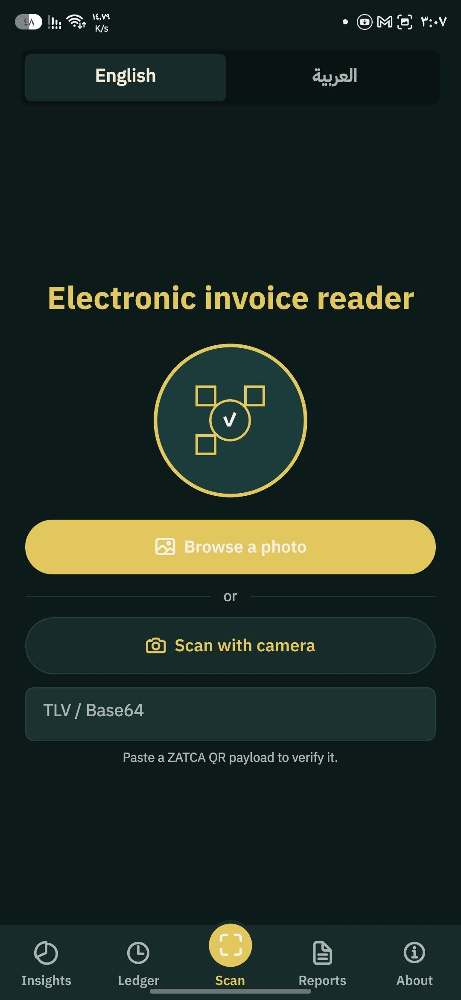
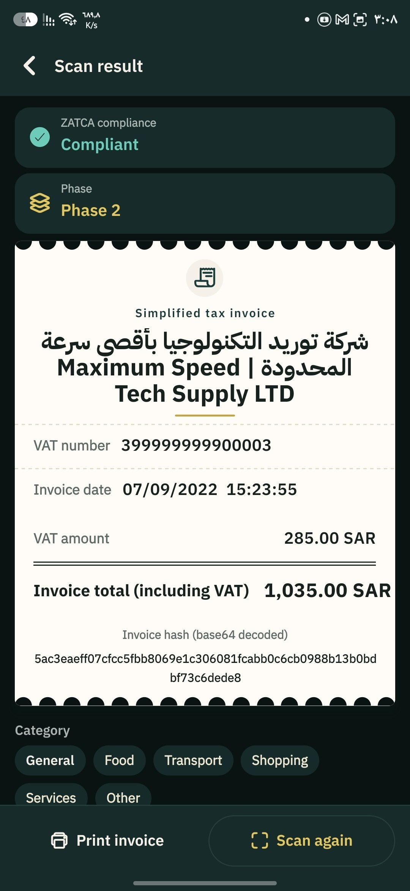
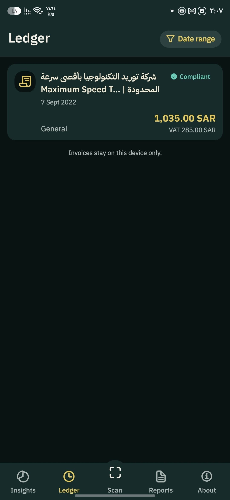
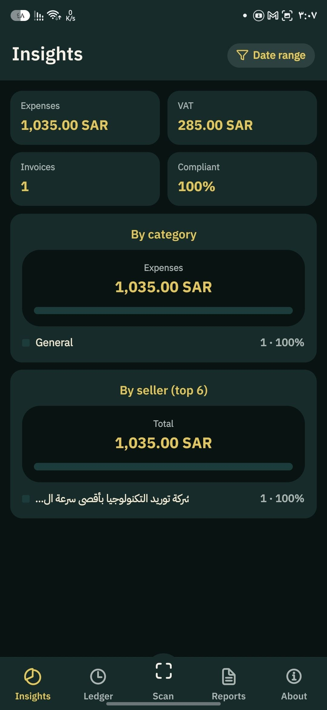
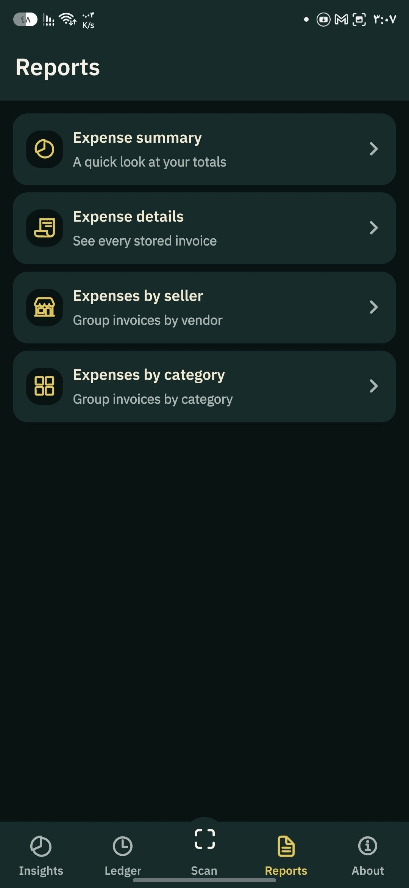
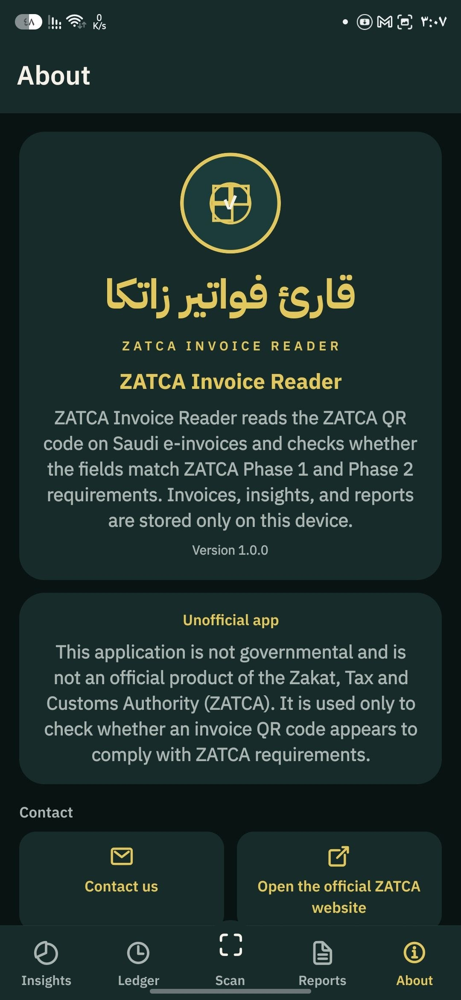

# ZATCA Invoice Reader

**قارئ فواتير زاتكا** is a mobile app that reads the QR code on Saudi electronic invoices, checks the fields against the public ZATCA TLV format, and keeps a private ledger on the device.

Scan with the camera, pick a photo, or paste a QR payload. Each invoice is decoded locally. Insights and reports are built from what you have already scanned. Nothing is uploaded.

> This app is **not** a product of the Zakat, Tax and Customs Authority (ZATCA), and it is **not** an official compliance tool. It only checks whether a QR payload looks like a ZATCA invoice code. It does not verify the cryptographic signature, the seller’s certificate, or the invoice with ZATCA’s systems. For official rules, use [zatca.gov.sa](https://zatca.gov.sa).

## Screenshots

<table>
  <tr>
    <td align="center" width="33%">
      
      <br /><b>Scan</b>
      <br />المسح
    </td>
    <td align="center" width="33%">
      
      <br /><b>Invoice</b>
      <br />نتيجة الفاتورة
    </td>
    <td align="center" width="33%">
      
      <br /><b>Ledger</b>
      <br />السجل
    </td>
  </tr>
  <tr>
    <td align="center" width="33%">
      
      <br /><b>Insights</b>
      <br />الإحصاءات
    </td>
    <td align="center" width="33%">
      
      <br /><b>Reports</b>
      <br />التقارير
    </td>
    <td align="center" width="33%">
      
      <br /><b>About</b>
      <br />حول التطبيق
    </td>
  </tr>
</table>

## Features

- Scan a ZATCA QR with the camera, from a photo, or by pasting the Base64 payload
- Decode Phase 1 fields: seller name, VAT number, timestamp, invoice total, and VAT amount
- Detect Phase 2 payloads when later TLV tags (invoice hash and related fields) are present
- Flag missing or malformed fields, including the 15-digit VAT number shape (`3` + 13 digits + `3`)
- Save invoices on the device and assign a category
- Insights by date range, category, and seller
- Reports: summary, line details, by seller, and by category
- Print a saved invoice
- English and Arabic, with right-to-left layout
- Light, dark, and system themes

## How a scan is checked

ZATCA invoice QR codes are Base64-encoded TLV (tag–length–value) bytes. This app reads those tags in `src/shared/lib/zatca.ts`:

| Tag | Field |
| --- | --- |
| 1 | Seller name |
| 2 | VAT registration number |
| 3 | Invoice timestamp |
| 4 | Invoice total (including VAT) |
| 5 | VAT amount |
| 6+ | Phase 2 fields, starting with the invoice hash |

A result is marked:

- **Compliant** when the five required tags are present and the values parse
- **Needs review** when a value is present but looks wrong (for example an invalid VAT number or timestamp)
- **Not compliant** when the payload is not TLV, required tags are missing, or a required amount cannot be parsed

Phase 2 is inferred from the presence of tags 6–9. The app stores the invoice hash when tag 6 is present. It does not validate the ECDSA signature or the cryptographic stamp.

## Privacy

Invoices, language, and theme are stored with AsyncStorage on the device (`zatcaqr_invoices` and related keys). There is no account, no backend, and no analytics in this repository. Deleting an invoice removes it from that local ledger.

## Requirements

- [Node.js](https://nodejs.org/) 20 or newer (developed on Node 24)
- [pnpm](https://pnpm.io/) 10 (`packageManager` is `pnpm@10.33.0`)
- [Expo](https://docs.expo.dev/versions/v58.0.0/) Go, or a local Android / iOS build, for the camera
- Android `adb` only if you use the USB start script

Camera and photo-library scanning need a native build or Expo Go. The web target can still paste a payload and browse invoices that were saved in that browser.

## Getting started

```bash
pnpm install
pnpm start
```

Then open the project in Expo Go, an emulator, or a development build.

USB debugging on Android (forwards Metro port 8081):

```bash
pnpm start:usb
```

Other targets:

```bash
pnpm android
pnpm ios
pnpm web
pnpm start:tunnel
```

## Scripts

| Script | What it does |
| --- | --- |
| `pnpm start` | Expo dev server |
| `pnpm start:usb` | `adb reverse` then start on localhost |
| `pnpm start:tunnel` | Dev server through an ngrok tunnel |
| `pnpm android` / `pnpm ios` / `pnpm web` | Run on that platform |
| `pnpm lint` | ESLint |
| `pnpm lint:fix` | ESLint with autofix |
| `pnpm format` | Prettier write |
| `pnpm format:check` | Prettier check |
| `pnpm typecheck` | `tsc --noEmit` |

Git hooks (installed by `pnpm install` via Husky):

- **pre-commit** runs lint-staged (ESLint and Prettier on staged files)
- **commit-msg** expects [Conventional Commits](https://www.conventionalcommits.org/) (`feat: …`, `fix: …`)

## Project layout

```
src/
  app/                 # Expo Router routes (thin re-exports)
  features/
    scan/              # Camera, gallery, and paste
    invoices/          # Decode result, detail, print, local ledger
    history/           # Saved invoices
    stats/             # Insights
    reports/           # Summary and grouped reports
    settings/          # Language and theme
    about/             # About and disclaimer
  shared/
    components/        # UI primitives
    theme/             # Tokens and theme provider
    i18n/              # English and Arabic
    lib/zatca.ts       # TLV encode / decode and field checks
    services/          # AsyncStorage
```

Path aliases: `@/*` → `src/*`, `@/assets/*` → `assets/*`.

Stack: Expo SDK 58, React Native 0.88, Expo Router, TypeScript, NativeWind 4, i18next.

## Contributing

1. Fork the repository and create a branch.
2. Keep user-facing copy in both `src/shared/i18n/locales/en.ts` and `ar.ts`.
3. Run `pnpm lint`, `pnpm typecheck`, and `pnpm format:check` before opening a pull request.
4. Use a Conventional Commit message.

Issues and pull requests are welcome, especially around TLV edge cases and clearer compliance messaging. Please do not send real customer invoices in issues; use synthetic QR payloads.

## Contact

[ezadeen.dev@gmail.com](mailto:ezadeen.dev@gmail.com)

## License

This repository does not include a license file yet. Until one is added, default copyright applies and reuse is not granted. Add a `LICENSE` file (for example MIT or Apache-2.0) before publishing the project as open source.
